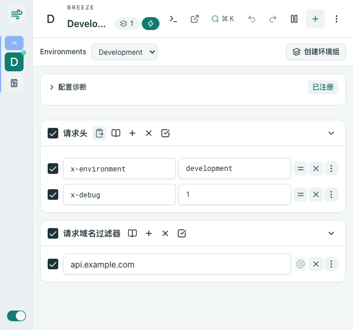

# Breeze

在浏览器里管理 HTTP 请求规则：修改 Header、切换联调环境、重定向、阻断与放行。

[下载](https://github.com/hzgcoding/breeze-extension/releases) · [使用文档](https://hzgcoding.github.io/breeze-extension/) · [更新记录](./extension/CHANGELOG.md)

## 能力

| 功能            | 行为                                                               |
|-----------------|--------------------------------------------------------------------|
| Header 编辑     | 修改请求头与响应头，支持设置、追加、移除和批量粘贴                   |
| 环境切换        | 互斥配置组一键切换，也可暂停整组                                     |
| cURL 导入       | 粘贴 Bash cURL，预览显式 Header、域名与方法，创建默认暂停的配置       |
| 分享与导出      | 常见认证 Header 默认脱敏，复制、文件和链接使用同一份预览数据          |
| 导入预检        | 展示配置与分组摘要、错误路径；校验通过后整体追加，默认暂停             |
| 规则诊断        | 查看注册状态、请求域名条件与潜在 Header 冲突                          |
| 请求控制        | 重定向、阻断、放行、升级 HTTPS，以及请求方法与资源类型等条件          |
| Cookie 与标签页 | 按需申请 Cookie 和标签页组权限，用于同步 Cookie 或限定标签页条件      |



界面采用青绿与石墨色，提供明暗主题、中英文界面，以及独立标签页编辑。

## 安装与更新

需要 Chrome 145 或更新版本。

1. 在 [Releases](https://github.com/hzgcoding/breeze-extension/releases) 下载 `breeze-vX.Y.Z-chrome.zip`，解压到一个固定目录。
2. 打开 `chrome://extensions`，启用「开发者模式」。
3. 选择「加载已解压的扩展程序」，选择包含 `manifest.json` 的目录，固定 Breeze 图标。
4. 更新时把新包覆盖到这个目录。UI 更新后重新打开弹窗；后台或 Manifest 更新后，在扩展页点击刷新，无需重新选择目录。

当前通过 GitHub Releases 分发，下载按钮不会跳转到其他产品的商店条目。

### 保留已有配置

同一个已加载目录更新时，扩展 ID 和浏览器本地配置保持不变。不要删除这个目录后换路径加载，也不要先卸载旧实例。

另一扩展实例中的配置可通过 JSON 导出后导入。Breeze 支持 version 1 与 version 2 交换格式；version 2 保留分组和成员关系。导入重新生成配置 ID 并追加，默认暂停；明确勾选保留文件启用状态后，才会启用原本已启用的配置。

## 分享与数据

配置与设置保存在本机，规则由 Chrome Declarative Net Request 执行，不代理流量，也不读取请求与响应体。

分享链接使用独立的文档站，配置位于 URL 的 `#profiles=` 片段中，由浏览器本地解码。未安装扩展时也可在分享页查看、复制或下载 JSON。文档搜索使用本地索引。

常见认证 Header 默认清空；同步 Cookie 值始终清空。脱敏按 Header 名称识别，自定义字段、URL 和备注仍需检查。分享内容经过压缩而非加密，单次导入、导出及解压后的分享内容上限为 1 MiB。

cURL 导入只重建显式 Header、域名和方法，不执行命令或重放请求体。域名条件包含子域名，不限定路径、协议或端口。空 Header 值沿用规则引擎原有行为，不生成修改操作；cURL 预检会拒绝无法表达的空值。

## 开发

需要 Node.js >=24.15.0，以及仓库 `packageManager` 指定的 pnpm。

```sh
pnpm install --frozen-lockfile
pnpm run dev
```

在 Chrome 加载 `extension/.output/chrome-mv3-dev`。生产构建与验证：

```sh
pnpm run lint
pnpm run typecheck
pnpm --filter extension exec vitest run
pnpm run build
pnpm --filter extension exec playwright install chromium
pnpm run test:e2e
pnpm run docs:build
```

### 更新已加载的固定目录

第一次指定目标目录，之后只需运行 `build:local`：

```sh
pnpm build:local --target /path/to/loaded-extension
pnpm build:local
```

目标路径仅保存在被 Git 忽略的 `.local-extension.json` 中。构建成功后先复制资源，再更新入口文件，保留已打开页面可能仍在使用的旧资源；不修改浏览器的配置存储。

## CI 与发布

| 入口                    | 行为                                                         |
|-------------------------|--------------------------------------------------------------|
| PR、推送 main、手动 CI  | 构建、类型、Lint、单测、文档构建及生产 Chromium E2E            |
| 推送 vX.Y.Z 标签        | 校验版本与 main 归属，完整验证后发布 ZIP、源码及 SHA-256        |
| main CI 通过            | 构建并部署独立文档站与分享页                                  |

使用仓库的 `GITHUB_TOKEN`，无需额外的发布凭据。版本标签必须与 `extension/package.json` 一致；商店发布不在当前流程中。

## 许可

[MIT](./LICENSE)。本项目包含 MIT 授权代码；原版权声明和第三方组件声明保留在源码中。
